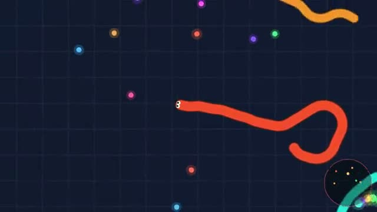

# Snake Arena

Eat to grow. Make others crash into you. A multiplayer starter game from [Multiplayer Agent](https://multiplayeragent.com): 2D, drop-in, 2–30 players, with bots that fill empty seats.

## How it plays

Steer with the mouse or a finger and hold to boost. Hit another snake and you turn into food for everyone else.

**Controls:** Mouse or touch to steer, hold or tap Boost to speed up.

## Make it yours in the Game Builder

Open the [Game Builder](https://multiplayeragent.com), choose **Start from a starter game** and pick Snake Arena. It opens as version 1 in your studio, ready to play and publish. Then ask for changes, for example:

- Make it underwater, with fish instead of snakes
- Add a speed pad in the middle of the map
- Let players pick a skin before they join

## Run it yourself

1. Get a free publishable key (`pk_…`) at [multiplayeragent.com](https://multiplayeragent.com).
2. In `index.html`, put it in place of `pk_REPLACE_ME` in the `MP_CONNECT` block.
3. Open `index.html` in a browser. No build step and no server needed.

Without a key it still runs, offline against bots.

## How it is built

- One `index.html`. The comment at the top of the script maps the code and explains the multiplayer.
- **Leaderboard:** Each player's longest snake, shown when you crash.
- **Bots:** Bots fill the arena until enough people join.
- **Live sync:** Every snake moves for everyone at once.
- `?attract` runs it offline with bots only. The preview video is recorded from it.

## License

MIT.
